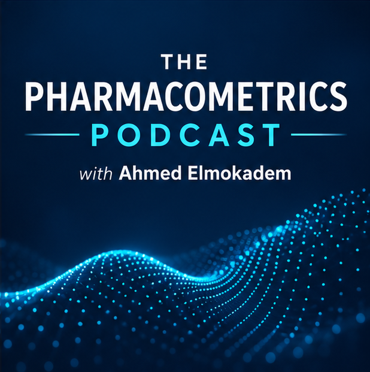

::: {.hero}
:::: {.hero-copy}
::: {.companion-label}
Technical Companion
:::

# Technical Notebooks & Resources

::: {.lead}
*Explore the models, mathematics, and code behind pharmacometrics.*
:::

Technical notebooks, mathematical explanations, simulations, and reproducible code exploring pharmacometrics and model-informed drug development. Build intuition, work through the equations, and run the models yourself.

[Explore technical resources](resources.qmd){.btn .btn-primary .mt-2}
::::

::: {.hero-artwork}

:::
:::

Some resources accompany episodes of *The Pharmacometrics Podcast*; others are standalone educational tutorials. Every notebook is written to be useful on its own, whether you are discovering a concept or revisiting its implementation.

The notebooks use modeling and simulation to explore how models work, what their assumptions mean, and how to interpret their results. Each notebook identifies the language and dependencies needed to reproduce its calculations.

## Explore the notebooks

Browse [published notebooks](resources.qmd#published-notebooks) by topic or search for a concept. Topics grow with the collection, from foundational PK/PD models to methods and applications in model-informed drug development.

The collection develops alongside the podcast, with new notebooks added as the material takes shape.

## Start here

[From Dose to Exposure to Response](notebooks/dose-exposure-response.qmd) follows hypothetical Compound X from IV and oral dosing to plasma concentrations and biomarker inhibition, using simple base R calculations.

## Explore the code

All notebook source code is available in the [GitHub repository](https://github.com/aelmokadem/pharmacometrics-podcast). Download the examples, run them yourself, or [suggest a topic](https://github.com/aelmokadem/pharmacometrics-podcast/issues).

## About the podcast

*The Pharmacometrics Podcast* explores pharmacometrics and the computational methods behind model-informed drug development. Visit [the main podcast website](https://aelmokadem.me/podcasts/pharmacometrics-podcast/) for episodes, descriptions, and listening links.

::: {.podcast-links aria-label="Listen to or watch the podcast"}
<a class="btn btn-outline-primary" href="https://open.spotify.com/show/54G0iCxWVSVeMsulbSlyr5"><i class="bi bi-spotify" aria-hidden="true"></i> Spotify</a>
<a class="btn btn-outline-primary" href="https://youtube.com/@pharmacometricspodcast"><i class="bi bi-youtube" aria-hidden="true"></i> YouTube</a>
<a class="btn btn-outline-primary" href="https://podcasts.apple.com/us/podcast/the-pharmacometrics-podcast/id6832096373"><i class="bi bi-apple" aria-hidden="true"></i> Apple Podcasts</a>
:::

## Contact

For questions, topic suggestions, or collaboration inquiries, email Ahmed Elmokadem at [podcast@aequantitative.com](mailto:podcast@aequantitative.com) or connect on [LinkedIn](https://www.linkedin.com/in/ahmed-elmokadem-87b01875/).
